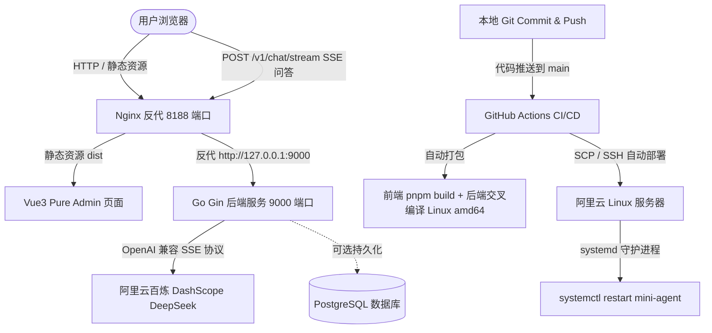

# 从零到一构建并落地 AI Agent 项目：Vue3 + Go Gin + 阿里云百炼 DeepSeek + 宝塔 + GitHub Actions CI/CD 实战与踩坑全纪录

> **导读**：本文记录了一个完整的现代全栈 AI Agent 项目从本地开发、流式大模型打通、自动化 CI/CD 编排，到最终部署在阿里云 Linux 服务器并使用宝塔面板进行统一纳管的全流程。文中不仅包含清晰的技术架构与部署步骤，更汇总了部署上线过程中踩过的 **7 个典型大坑与最佳实践解决方案**。

---

## 一、 系统架构与技术选型

本项目（`mini-agent`）定位为一个轻量但具备生产级架构规范的 AI Agent 会话工作台：



### 技术栈选型：
1. **前端（Frontend）**：
   - 框架：`Vue 3` + `TypeScript` + `Vite` + `Element Plus`
   - 脚手架：`pure-admin-thin`（极简且企业级规范的中后台模板）
   - 特性：自制 AI 智能会话工作台、`markdown-it` 实时渲染、`🧠 深度思考过程`折叠面板、HTTP SSE（Server-Sent Events）打字机流式输出。
2. **后端（Backend）**：
   - 语言与框架：`Go` + `Gin`
   - AI SDK：`github.com/sashabaranov/go-openai`（使用 OpenAI 兼容协议直连百炼兼容端点）
   - 架构：JWT 鉴权、跨域 CORS、Gzip 压缩、系统级服务守护。
3. **AI 模型基础设施**：
   - 平台：阿里云百炼（DashScope）
   - 协议：OpenAI Compatible API (`https://dashscope.aliyuncs.com/compatible-mode/v1`)
   - 模型：`deepseek-v4.1-flash` / `deepseek-v4-pro`（具备极速推理与深度思考 Reasoning 能力）
4. **服务器与运维环境**：
   - 云厂商：阿里云轻量应用服务器（CentOS / Linux）
   - 面板：宝塔 Linux 面板（Pagoda Panel）
   - 自动化：GitHub Actions（构建、打包、免密传输、无缝热重启）

---

## 二、 完整搭建实战步骤

### 阶段一：本地项目开发与 AI 流式交互打通

1. **后端 Gin 集成 DeepSeek 兼容接口**：
   - 配置环境参数（`.env`）：
     ```env
     PORT=9000
     ENV=PRODUCTION
     DEEPSEEK_API_KEY="sk-********************************"
     DEEPSEEK_BASE_URL="https://dashscope.aliyuncs.com/compatible-mode/v1"
     DEEPSEEK_MODEL="deepseek-v4.1-flash"
     ```
   - 编写 `controllers/chat.go`，建立 SSE 流式传输控制器：
     ```go
     c.Writer.Header().Set("Content-Type", "text/event-stream")
     c.Writer.Header().Set("Cache-Control", "no-cache")
     c.Writer.Header().Set("Connection", "keep-alive")
     c.Writer.Header().Set("X-Accel-Buffering", "no") // 关键：通知 Nginx 禁用响应缓冲
     ```
   - 支持解析 `delta.Content`（回答文本）以及 `delta.ReasoningContent`（思考过程），封装为结构体推流。

2. **前端 Pure Admin 定制 AI 对话面板**：
   - 新增路由 `src/router/modules/chat.ts` 与视图组件 `src/views/chat/index.vue`。
   - 使用浏览器原生 `fetch` 与 `ReadableStreamDefaultReader` 逐块解码服务端下发的 `data: {...}`，实时渲染思考折叠块与 Markdown 正文。

---

### 阶段二：服务器环境配置与宝塔部署

1. **宝塔面板新建 Nginx 静态站点**：
   - 域名/IP 填入：`<YOUR_SERVER_IP>`（或 `***.***.***.***`）
   - 监听端口：`8188`
   - 网站根目录指向前端打包目录：`/www/wwwroot/mini-agent/frontend/dist`
2. **Nginx 配置文件配置（核心）**：
   在宝塔该站点的“配置文件”中追加接口反向代理与前端单页刷新配置：
   ```nginx
   server {
       listen 8188;
       server_name <YOUR_SERVER_IP>;
       root /www/wwwroot/mini-agent/frontend/dist;
       index index.html;

       # 1. 解决 Vue 单页应用刷新 404
       location / {
           try_files $uri $uri/ /index.html;
       }

       # 2. 反向代理到 Go 后端端口 (9000) 并打通 SSE 流式输出
       location /v1/ {
           proxy_pass http://127.0.0.1:9000;
           proxy_set_header Host $host;
           proxy_set_header X-Real-IP $remote_addr;
           proxy_set_header X-Forwarded-For $proxy_add_x_forwarded_for;
           
           # SSE 流式推送关键配置
           proxy_buffering off;
           proxy_cache off;
           proxy_read_timeout 600s;
           chunked_transfer_encoding on;
       }
   }
   ```
3. **系统级服务守护（Systemd）**：
   编写后端守护脚本 `backend/deploy-server.sh`，生成 `/etc/systemd/system/mini-agent.service`：
   ```ini
   [Unit]
   Description=Mini-Agent Go Backend
   After=network.target

   [Service]
   Type=simple
   User=root
   WorkingDirectory=/www/wwwroot/mini-agent/backend
   ExecStart=/www/wwwroot/mini-agent/backend/server
   Restart=always
   RestartSec=3
   StandardOutput=append:/www/wwwroot/mini-agent/backend/app.log
   StandardError=append:/www/wwwroot/mini-agent/backend/app.log

   [Install]
   WantedBy=multi-user.target
   ```

---

### 阶段三：GitHub Actions CI/CD 自动化流水线配置

配置 `.github/workflows/deploy.yml`，实现开发分支只要执行 `git push origin main`，云端自动编译并热更新到服务器：

1. **设置 GitHub Repository Secrets**：
   - `SERVER_HOST`: 服务器公网 IP（`***.***.***.***` 或 `<YOUR_SERVER_IP>`）
   - `SERVER_PORT`: SSH 端口（`22`）
   - `SERVER_USER`: 用户名（`root`）
   - `SERVER_SSH_KEY`: 私钥内容（或 `SERVER_PASSWORD` 密码）

2. **CI/CD 核心工作流逻辑**：
   - **Frontend Job**：安装 Node 20，运行 `pnpm install` 和 `pnpm build`，生成 `dist/`。
   - **Backend Job**：配置 Go 1.22，通过 `CGO_ENABLED=0 GOOS=linux GOARCH=amd64 go build -o server main.go` 进行无依赖静态交叉编译。
   - **Deploy Job**：
     - 使用 `appleboy/scp-action` 将前端 `dist` 和后端可执行二进制 `server` 传输至服务器目标目录；
     - 使用 `appleboy/ssh-action` 远程执行部署脚本，触发 `systemctl daemon-reload && systemctl restart mini-agent`。

---

## 三、 部署运维中踩过的 7 个典型大坑与解决方案

### 坑 1：Nginx 默认缓冲区拦截导致 SSE 打字机效果失效
- **现象**：前端发消息后，AI 对话框一直转圈卡顿，等待 10~20 秒后，所有文字“轰”地一下子全部蹦出来，完全没有流式打字机的丝滑效果。
- **原因**：Nginx 默认开启了 `proxy_buffering on;`（响应缓冲区）。Nginx 会尝试将后端吐出的内容缓冲到一定字节数（或直到连接关闭）才一次性发给浏览器。
- **解决办法**：
  1. 在后端的 HTTP Header 中下发：`X-Accel-Buffering: no`；
  2. 在 Nginx 反代配置中显式关闭缓冲：
     ```nginx
     proxy_buffering off;
     proxy_cache off;
     chunked_transfer_encoding on;
     ```

---

### 坑 2：阿里云控制台防火墙与宝塔安全双重拦截
- **现象**：宝塔面板里显示 Nginx 已经在 `8188` 端口正常运行，宝塔的“安全”界面也放行了 `8188`，但在外网浏览器始终无法访问 `http://<YOUR_SERVER_IP>:8188`（连接超时 ERR_CONNECTION_TIMED_OUT）。
- **原因**：云厂商（阿里云轻量服务器 / ECS）在外层还有一道**独立的安全组/防火墙规则**。宝塔内部改动的是操作系统内的 `iptables/firewalld`，穿透不了外层云控制台。
- **解决办法**：
  - 登录阿里云轻量应用服务器管理后台 -> 进入【防火墙】页面 -> 点击【添加规则】-> 协议选择 TCP，端口填入 `8188` 予以放行。

---

### 坑 3：GitHub Actions 执行后台进程卡死超时（Status 143 / Timeout）
- **现象**：在 GitHub Actions 流水线中通过 SSH 远程执行 `nohup ./server &` 或 `./start.sh &` 时，GitHub Actions 会一直卡在该步骤旋转不结束，最终在 30 秒或数分钟后超时失败退出（Exit status 143）。
- **原因**：SSH Client 在执行远程命令时，如果被启动的后台进程依然继承了当前终端会话的标准输入输出（stdin / stdout / stderr），SSH 连接就不会主动断开，必须等到输入输出流关闭。
- **解决办法**：
  1. **生产级推荐**：将后台进程完全托付给 Linux 系统服务 `systemd`，脚本只执行 `systemctl restart mini-agent`，0.5 秒极速返回；
  2. 兜底方案：如果要用 nohup，必须显式重定向所有流并断开：`nohup ./server > app.log 2>&1 < /dev/null &`。

---

### 坑 4：阿里云百炼 DeepSeek 模型名称与官方规范不一致（404 NotFound）
- **现象**：调用接口时，阿里云百炼接口返回 HTTP 404：`Model 'deepseek-v3' does not exist`。
- **原因**：在百炼平台使用 OpenAI 兼容模式时，模型名不能直接填通用的 `deepseek-v3`，必须使用百炼控制台开通的具体模型代码（例如 `deepseek-v4.1-flash`、`deepseek-v4-pro` 或带后缀的官方模型标识）。
- **解决办法**：
  - 检查阿里云百炼模型广场中实际生效开通的模型编码；
  - 在 `.env` 中严格匹配：`DEEPSEEK_MODEL="deepseek-v4.1-flash"`。

---

### 坑 5：Shell 中 sed 正则转义陷阱导致环境变量未被替换
- **现象**：在服务器终端执行替换命令尝试将 `$(openssl rand -hex 32)` 替换为真实随机串时，多次执行依然无效。
- **原因**：在 Bash 中执行 `sed -i "s/\$(openssl...)/..."` 时，由于使用了双引号加反斜杠，`$` 在正则中是“匹配行尾”的元字符（Anchor）。当没有正确转义时，模式串变成了匹配“行尾接着 `(openssl`”，导致永远匹配不到任何文本。
- **解决办法**：在初始化环境时，直接通过脚本动态生成并输出完整变量值，或者使用单引号界定 sed 命令。

---

### 坑 6：看似运行中的“假活”死循环崩溃（20ms ago）与 502 Bad Gateway
- **现象**：前端发起会话时提示 `⚠️ 请求异常：请求失败 (502)`。在服务器运行 `systemctl status mini-agent`，显示是绿色的 `Active: active (running)`，但只要在前端发消息就会 502。
- **原因**：仔细观察 systemd 输出：`active (running) since ... 20ms ago`。
  - 这是极其典型的“**崩溃死循环**”。由于后端代码中原模板默认执行了 `db.Init()` 连接 PostgreSQL 以及强校验 32 位 JWT 密钥；
  - 服务器上并没有运行 PostgreSQL，导致代码一执行到连接数据库就触发 `log.Fatal` **立刻崩溃自杀**；
  - 接着 systemd 守护进程检测到退出又立即拉起，整个进程在反复的“启动 20ms -> 崩溃 -> 3秒后重启”之间无限循环；
  - 请求到达 Nginx 时恰好后端处于挂掉状态，因此 Nginx 报 502 错误。
- **解决办法**：
  - **架构解耦**：AI 会话接口完全独立于 PostgreSQL，将 `db.Init()` 里的 `log.Fatal` 改为非阻塞告警日志（`log.Printf`）；
  - **安全容错**：对未配置的 JWT Secret 自动生成内存级安全兜底串，确保 AI 核心服务不会因为外围持久化组件未启动而被阻断。

---

### 坑 7：跨操作系统交叉编译的 CGO 陷阱
- **现象**：本地在 macOS（Darwin ARM64 / M 系列芯片）上开发，直接编译出来的可执行文件拷贝到阿里云 CentOS/Ubuntu 服务器上报 `cannot execute binary file: Exec format error` 或缺少动态链接库 `.so`。
- **原因**：不同操作系统与 CPU 架构的 ELF 格式不兼容，且开启 CGO 时依赖本地的 C 运行时环境。
- **解决办法**：
  - 在 CI/CD 流水线中明确指定交叉编译环境变量：
    ```bash
    CGO_ENABLED=0 GOOS=linux GOARCH=amd64 go build -o server main.go
    ```
  - `CGO_ENABLED=0` 保证生成纯静态链接的二进制文件，无需服务器额外安装 glibc 等运行库，体积小且即拷即用。

---

## 四、 项目沉淀与未来展望

通过本次全流程打通，项目已经拥有了一条标准的工程化闭环路径：
1. **开发者体验（DX）**：本地仅需关注 Vue3 交互美化与 Go 业务逻辑，`git push` 后 1 分钟内自动部署上线并自动重启；
2. **高稳定性**：后端由 `systemd` 接管，具备开机自启、故障自愈、崩溃重启以及日志自动归档能力；
3. **架构清晰**：AI 流式能力与数据库持久化解耦，保证了轻量级场景下的高可用。

后续迭代演进建议：
- **Agent 工具调用（Function Calling）**：扩展后端控制器，支持百炼 Tool/Plugin 协议，实现自动联网搜索与代码执行；
- **会话持久化**：配置轻量级 SQLite 或在服务器启动 PostgreSQL 容器，支持多轮历史对话漫游与会话持久化存储；
- **HTTPS 证书自动化**：在宝塔面板为 `8188` 或绑定独立域名申请 Let's Encrypt 免费 SSL 证书，启用 HTTP/2 进一步提升流式传输性能。
