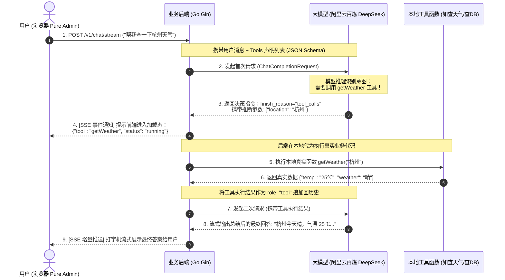

# 阶段二：Agent 核心灵魂 —— Tool Calling（函数/工具调用）完全实战指南

> **前言**：只会文字问答的叫 **ChatBot（聊天机器人）**，能自主决策调用工具办实事的才叫 **Agent（智能体）**。
> 本指南专为**前端/全栈开发者进阶 AI Agent 方向**编写，每个核心技术点均配备**【真实面试题 + 考点透析 + 满分回答话术 + 动手实战代码】**，助你吃透底层原理，掌握硬核技术。

---

## 目录
- [一、全局认知：Tool Calling 底层到底经历了什么？](#一全局认知tool-calling-底层到底经历了什么)
- [二、技术点 1：JSON Schema 与 Function Definition（工具契约）](#二技术点-1json-schema-与-function-definition工具契约)
- [三、技术点 2：大模型二次往返握手时序（两次请求与生命周期）](#三技术点-2大模型二次往返握手时序两次请求与生命周期)
- [四、技术点 3：SSE 扩展与前端加载状态机（流式工具卡片）](#四技术点-3sse-扩展与前端加载状态机流式工具卡片)
- [五、自己动手实操手册（Step-by-Step）](#五自己动手实操手册step-by-step)
- [六、阶段二面试终极复盘与串讲总结](#六阶段二面试终极复盘与串讲总结)

---

## 一、全局认知：Tool Calling 底层到底经历了什么？

### 1.1 核心底层常识（打破误区）
> ❌ **误区**：大模型自己会联网、会执行 Python 代码、会查数据库。  
> ✅ **真相**：大模型本质是一个**纯文本概率预测模型**，它没有网卡，碰不到操作系统，执行不了任何代码！

### 1.2 两次握手通信时序图
所谓 Tool Calling，是**客户端（后端服务）与大模型之间定义的一套两阶段协商协议**：



---

## 二、技术点 1：JSON Schema 与 Function Definition（工具契约）

### 2.1 为什么要这么做？
计算机如何向模型描述一个函数？答案是使用 **JSON Schema**。  
我们把函数名（`Name`）、函数用途说明（`Description`）以及入参结构（参数类型、字段名、必填项、每个参数的中文释义）以标准 JSON 结构传递给大模型。

大模型通过**自然语言语义理解**你的 `Description`，从而决定“要不要用这个工具”以及“怎么把用户的一句话提取为参数”。

### 🎤 常见大厂面试题 1
> **面试官提问**：  
> *“在实现 Tool Calling 时，模型是怎么知道何时该调工具、入参怎么填的？如果大模型经常调错工具或者入参格式错误，你在工程上怎么解决？”*

* **3 个词记忆小抄**：**写清楚说明书、后端加校验、把报错喂回去**
* **🗣️ 大白话回答**：
  > “其实大模型自己根本不会上网，也不会调任何函数。我们做的事情，本质上就是给模型递了一份**工具说明书**（用 JSON 描述）。
  > 
  > 比如查天气，我就告诉它：我这有个函数叫 `get_weather`，接收一个城市名。模型看了用户的问题‘杭州天气怎么样’，发现自己不知道，但说明书里有这个工具，它就会照着要求，从用户的话里抠出‘杭州’这两个字填进去。
  > 
  > 如果模型偶尔‘抽风’把参数填错了，我们在工程上主要做两件事：
  > 1. 第一是**把说明书写得更明白**，比如明确写‘只能填城市名，不要填日期’；
  > 2. 第二是**后端做兜底**。模型给的参数不能直接信，Go 后端反序列化时如果发现格式不对，不要直接报 500 挂掉，而是把‘参数不对’这句话当成结果再喂给模型，让模型看一眼重新纠正。”

---

## 三、技术点 2：大模型二次往返握手时序（两次请求与生命周期）

### 3.1 核心数据结构：消息上下文组装
在第一次请求中，消息列表长这样：
```json
[
  { "role": "user", "content": "杭州今天天气怎么样？" }
]
```

当模型决定调用工具后，发起第二次请求前，Go 后端必须组装出**符合 OpenAI / 百炼规范的完整上下文**：
```json
[
  { "role": "user", "content": "杭州今天天气怎么样？" },
  {
    "role": "assistant",
    "tool_calls": [
      {
        "id": "call_123456",
        "type": "function",
        "function": { "name": "get_weather", "arguments": "{\"location\":\"杭州\"}" }
      }
    ]
  },
  {
    "role": "tool",
    "tool_call_id": "call_123456",
    "name": "get_weather",
    "content": "{\"weather\":\"晴\",\"temp\":\"25℃\"}"
  }
]
```

> ⚠️ **关键细节**：
> 1. 必须先把模型返回的 `assistant`（带 `tool_calls`）加进列表；
> 2. 再把本地执行工具的结果以 `role: "tool"` 且带对应 `tool_call_id` 加进列表；
> 3. 缺了任何一个，模型 API 会直接报 `400 Bad Request: missing tool response for call_id`！

### 🎤 常见大厂面试题 2
> **面试官提问**：  
> *“大模型调用本地工具时，如果本地工具执行特别慢（比如爬虫爬取了 10 秒，或者查 SQL 用了 5 秒），HTTP 连接会断开吗？你在前端和后端分别怎么处理这种长耗时工具调用？”*

* **3 个词记忆小抄**：**先推加载中、发心跳保活、加超时熔断**
* **🗣️ 大白话回答**：
  > “这在实际业务中很常见，比如查个很慢的数据库或者调三方 API 耗时好几秒。如果什么都不做，前端页面就会死死卡住，用户以为断网了。
  > 
  > 我们当时是这么设计的：
  > 1. **先给前端报个信**：后端一旦拿到大模型想调工具的指令，在**真正执行那个慢函数之前**，就先通过 SSE 给前端推一条消息：‘正在查询中’，让前端页面先把齿轮转起来，给用户心理预期；
  > 2. **加超时保护**：我们后端给每个工具都加了比如 5 秒或者 8 秒的 Context 超时。如果时间到了还没查出来，赶紧停掉，告诉模型‘接口超时了’，让模型客气地跟用户道歉，千万不能让整个请求无限期僵死在那。”

---

## 四、技术点 3：SSE 扩展与前端加载状态机（流式工具卡片）

### 4.1 协议升级：从纯文本流到富事件流
在阶段一中，我们的 SSE 只吐出两种数据：
- `data: {"content": "你好"}`
- `data: {"reasoning": "正在思考..."}`

在阶段二中，我们需要为前端扩展出**工具状态事件**：
- `data: {"tool_name": "get_weather", "tool_args": "{\"location\":\"杭州\"}", "tool_status": "calling"}`
- `data: {"tool_name": "get_weather", "tool_result": "25℃ 晴", "tool_status": "done"}`

### 4.2 前端状态机流转
在 Vue 组件内，单条消息的气泡从单纯的文本渲染，升级为三段式状态流：

```
[ 🧠 深度思考过程折叠块 (Reasoning) ]
         ↓
[ ⚙️ 外部工具调用状态卡片 (Tool Status) ] 
   - 状态 1: 正在调用工具 getWeather(杭州)...
   - 状态 2: 调用完成，返回 25℃ 晴朗
         ↓
[ 💬 最终生成的回答正文 (Markdown Text) ]
```

### 🎤 常见大厂面试题 3
> **面试官提问**：  
> *“前端在消费 SSE 流时，如何优雅地处理大模型吐出的非文本信息（例如工具调用中、图表生成、审批确认按钮）？如何防止频繁更新 DOM 导致页面卡顿？”*

#### 🎯 考点透析
考察前端流式协议设计能力、富交互组件封装能力、以及高频流更新下的性能优化（虚拟滚动/防抖/requestAnimationFrame）。

#### 💡 满分回答话术：
> “在处理富媒体流时，核心是将后端的纯文本打字机升级为**结构化分片流（Structured Chunk Stream）**。
> 1. **结构化协议设计**：在 SSE 的 `data` 载荷中约定统一的 JSON 协议，通过 `type` 字段区分 `reasoning`（思考）、`tool`（工具动作）、`text`（正文）以及 `control`（控制事件）。前端根据消息块的 `type` 路由给不同的子组件进行增量渲染；
> 2. **状态解耦卡片**：将工具调用设计为一个内嵌卡片组件，具有 `loading`、`success`、`failed` 三种响应式状态，用户可以清晰感知到智能体‘正在思考 ➔ 正在调用接口 ➔ 获取数据 ➔ 输出结论’的完整心智模型；
> 3. **性能渲染优化**：大模型每秒可能下发数十个小 token，如果每个 token 都触发 Vue 模板响应式更新与 Markdown 全量编译，会导致 CPU 飙升。我在工程中使用 `requestAnimationFrame` 或 30ms 节流缓冲区，将高频 token 合并批量更新视图，保证流式打字与吸底滚动的丝滑度。”

---

## 五、自己动手实操手册（Step-by-Step）

现在，让我们一起编写代码，完成阶段二的功能！请按照以下 4 个步骤自主实现：

---

### 📝 Step 1：在 Go 后端创建工具包与工具实现

在 `backend/` 目录下新建一个 `tools` 包，编写工具函数以及它的 JSON Schema 描述。

👉 **目标创建文件**：[backend/tools/weather.go](file:///Volumes/ORICO/Desktop_backup/test/mini-agent/backend/tools/weather.go)

```go
package tools

import (
	"encoding/json"
	"fmt"
	openai "github.com/sashabaranov/go-openai"
	"github.com/sashabaranov/go-openai/jsonschema"
)

// 1. 定义该工具入参的 Go 结构体
type WeatherParams struct {
	Location string `json:"location" jsonschema:"description=要查询天气的城市名称，如：杭州、北京"`
}

// 2. 本地真实业务函数（这里模拟调用三方天气 API，实际中也可接高德天气 API 或查数据库）
func GetWeather(arguments string) string {
	var params WeatherParams
	if err := json.Unmarshal([]byte(arguments), &params); err != nil {
		return fmt.Sprintf(`{"error": "参数解析失败: %v"}`, err)
	}
	
	// 模拟返回结构化数据
	return fmt.Sprintf(`{"location": "%s", "weather": "晴朗", "temperature": "26℃", "wind": "东南风 2 级", "tips": "气温适宜，推荐外出！"}`, params.Location)
}

// 3. 构建提供给大模型的 OpenAI Tools 声明清单
func GetToolDefinitions() []openai.Tool {
	return []openai.Tool{
		{
			Type: openai.ToolTypeFunction,
			Function: &openai.FunctionDefinition{
				Name:        "get_weather",
				Description: "查询指定城市的当前实时天气情况、气温以及出行穿衣建议",
				Parameters: jsonschema.Definition{
					Type: jsonschema.Object,
					Properties: map[string]jsonschema.Definition{
						"location": {
							Type:        jsonschema.String,
							Description: "城市名称，例如：杭州、上海、北京",
						},
					},
					Required: []string{"location"},
				},
			},
		},
	}
}

// 4. 工具路由器：根据大模型返回的名字分发执行
func ExecuteTool(name string, args string) string {
	switch name {
	case "get_weather":
		return GetWeather(args)
	default:
		return fmt.Sprintf(`{"error": "未知工具: %s"}`, name)
	}
}
```

---

### 📝 Step 2：修改控制器支持工具决策与二次握手

打开 [backend/controllers/chat.go](file:///Volumes/ORICO/Desktop_backup/test/mini-agent/backend/controllers/chat.go)：

1. 在调用模型时传入 `Tools: tools.GetToolDefinitions()`；
2. 如果模型在流中返回了 `tool_calls`，暂存该调用；
3. 执行 `tools.ExecuteTool(call.Function.Name, call.Function.Arguments)`；
4. 将结果打包进 `chatMsgs`，发起二次流式请求并推回给前端。

---

### 📝 Step 3：前端 Vue 增加工具调用卡片

打开 [frontend/src/views/chat/index.vue](file:///Volumes/ORICO/Desktop_backup/test/mini-agent/frontend/src/views/chat/index.vue)：
在消息气泡上方，在思考折叠块下面，加入工具状态条展示：
```html
<!-- 工具调用中/调用完成卡片 -->
<div v-if="msg.tool" class="tool-call-box">
  <div class="tool-call-header">
    <el-icon class="is-loading" v-if="msg.tool.status === 'running'"><Loading /></el-icon>
    <el-icon v-else style="color: #67c23a"><CircleCheck /></el-icon>
    <span>{{ msg.tool.status === 'running' ? '正在调用工具：' : '已完成工具执行：' }}{{ msg.tool.name }}</span>
  </div>
  <div class="tool-call-detail" v-if="msg.tool.result">
    <code>{{ msg.tool.result }}</code>
  </div>
</div>
```

---

## 六、阶段二面试终极复盘与串讲总结

当你把上述代码敲完并成功跑通后，在面试中如果被问到 **“介绍一下你的 AI Agent 项目”**，你就可以用这段话惊艳全场：

> **3 分钟全景面试介绍范例**：  
> “我在这个项目中核心主导了从 ChatBot 到自主智能体（Agent）的演进设计。传统聊天机器人只能做静态文本生成，而我构建的系统基于 **OpenAI Compatible 协议的 Tool Calling 标准**，实现了大模型对本地服务接口的自主感知与按需调用。
> 
> 在架构设计上，我将整个交互划分为**契约定义、意图决策、本地执行、二次握手**四个阶段。后端使用 JSON Schema 严格声明入参约束与语义描述，当大模型判断需要外部数据时，触发 `finish_reason=tool_calls` 中断；后端在通过安全校验后在本地代为执行业务操作，并无缝组装带 `tool_call_id` 的消息历史发起二次会话。
> 
> 在前端体验上，针对工具调用可能产生的长耗时等待痛点，我通过 HTTP SSE 扩展了结构化事件流，在工具启动与完成的节点向前端推发状态帧，配合 Vue 3 实现了‘深度思考 ➔ 工具执行动画 ➔ 最终结果流式渲染’的三段式状态机，彻底解决了用户在复杂 Agent 任务中的焦虑感。”

---

💡 **下一步行动建议**：  
你可以现在本地尝试创建 `backend/tools/weather.go`，写好后告诉我，我们一起进行 Step 2 的联调推进！遇到任何代码细节疑惑随时讨论！
